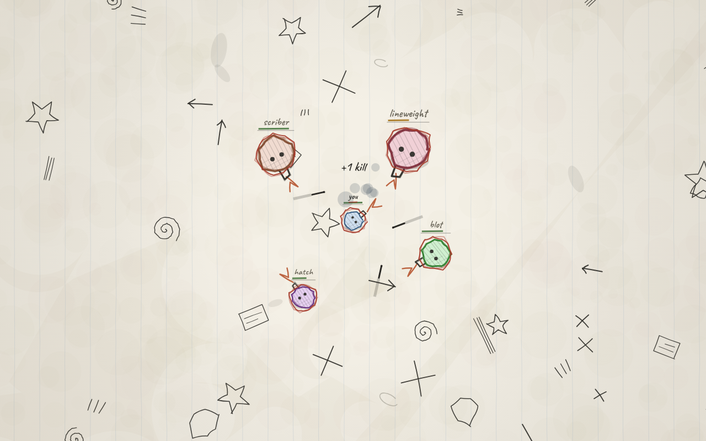

# websimbot<span>IO</span>

A fan-made, browser-based .io shooter that looks like it was scribbled in someone's
notebook. Walk around. Shoot people. Every kill makes you bigger and slower.

Multiplayer runs entirely on Supabase: the renderer is a slow-changing canvas of
hand-drawn wobbles, and **all of the physics is re-run inside Postgres**.



```
npm install
npm run dev      # http://localhost:5173
npm run build    # static build in dist/
```

No login, no accounts. Pick a name, pick a room, play. Share the URL — `?room=xyz`
drops people straight into the same sketchbook.

---

## How it plays

- **Move** WASD / arrows, or the left thumb-stick on touch.
- **Aim** with the mouse, or the right thumb-stick on touch (it fires while you hold it).
- **Shoot** with left click or space. Aim assist kicks in only if you have no pointer at all.
- **Kill** someone and you eat a share of their mass. Mass makes you fatter: fatter
  players hit a little harder but walk noticeably slower and are far easier to hit.
  Dying resets you to spawn size — your kill count survives.
- First to **25 kills** wins the page; a new one starts automatically.
- Empty rooms fill themselves with sketched bots, so there is always a fight.

## Netcode: client-side movement, server-side truth

This was the whole point of the project, so it is worth writing down.

**The client owns the feel.** Your browser integrates your own movement every frame
at whatever rate the display runs, so walking is smooth on a 144 Hz monitor and on a
hotel Wi-Fi connection alike. Ten times a second it sends a packet with:

| field | meaning |
| --- | --- |
| `p_fx`, `p_fy` | input direction, normalised |
| `p_aim` | aim angle |
| `p_shoot` | trigger held |
| `p_x`, `p_y` | **the position the client believes it is at** |
| `p_seq` | monotonic sequence number, so replays are useless |
| `p_since` | last event id seen, for the kill feed |

**Postgres is the referee.** `wsb.simulate()` re-derives every position itself from
the input flags — the claimed position is never trusted, it only bounds the error.
Concretely, on every tick the server:

1. Normalises the input vector, rejects `NaN`, and drops packets whose `p_seq` is
   not strictly newer than the last one it accepted.
2. Budgets how far you could possibly have travelled: `speed(radius) × elapsed × 2 + 60 px`.
   Anything beyond that is a **teleport attempt**; the packet is refused, no input is
   applied, and the response carries the server's real coordinates.
3. Moves you with its own velocity, clamps you inside the arena, and applies the
   fire cooldown itself (holding the trigger cannot beat the timing).
4. Sweeps each bullet as a **segment**, not a point, so a 900 px/s round cannot tunnel
   through a player between ticks. Only the server decides that a hit happened, how
   much damage it did, and who grew how much.
5. Awards the kill, grows the killer, and checks the win condition.

**The client snaps back when it's wrong.** On each snapshot the client compares the
server's position for itself against its own prediction. A few pixels is just tick
alignment, so it eases toward the server over a couple of frames. A large gap means
the server refused something: it jumps to the server's position and flashes a red
edge so the correction is visible instead of hidden.

Two rate limits keep this cheap: `wsb.pump()` only advances the simulation when
wall-clock time has actually moved past the last tick, and it takes a per-match
advisory lock so two clients arriving at once cannot double-step a match. A pg_cron
heartbeat steps the match at 1 Hz even with nobody connected, so bots keep fighting
and a match still ends on its own.

### Why Postgres is the server

There is no separate game server to deploy, scale or pay for: the authoritative loop
is a SQL function that ships with the project, and the client talks to it over
PostgREST. It is unusual, it is not what you'd do for a competitive shooter, and it
is completely adequate for a sketchbook with fourteen people in it.

## Data model

Everything lives in the `wsb` schema (see `supabase/migrations/`):

- `wsb.matches` — one row per page/room, with its own tick counter and wall clock.
- `wsb.players` — authoritative position, mass, hp, score, plus the last input packet.
- `wsb.bullets` — swept each tick, capped at 500 rows per match.
- `wsb.events` — short-lived `hit` / `kill` / `join` / `respawn` feed, trimmed to the
  last six seconds.

Security notes:

- Clients have **no write grants** on any table. `wsb_join`, `wsb_pump`, `wsb_respawn`,
  `wsb_leave` and `wsb_room` are the only callable functions, all `SECURITY DEFINER`,
  and all of them validate their arguments.
- `wsb.players` is not readable through PostgREST at all — only `wsb.matches`' non-secret
  columns are. If `client_id` leaked, anyone could forge input for someone else.
  Snapshots come from `wsb.snapshot()` and contain no identifiers, only names and state.
- The anon key in `src/config.js` is a *publishable* key. That is what it is for. Every
  dangerous operation is gated behind the functions above.

## The look

No sprite sheet, no image assets, no shaders:

- `src/render/paper.js` generates the paper — mottling, a faint blue grid, a vignette —
  and provides the two primitives everything else uses: `sketchPath` (a polyline drawn
  twice with seeded jitter) and `sketchBlob` (a closed wobbly shape with a washed fill
  and a second hatch pass). Seeds are derived from the player id, so each character's
  wobble is stable instead of boiling.
- `src/render/arena.js` draws players as hatched blobs with eyes that track their aim
  and a pencil barrel, plus 120 seeded doodles per room: stars, spirals, arrows, spirals
  of margin notes. The same room always has the same doodles.
- UI is DOM, but the borders are a pair of mismatched `border-radius` rings and the
  two fonts are Caveat and Cabin Sketch, self-hosted through `@fontsource`.

## Repository layout

```
src/
  main.js            game loop, camera, HUD, state wiring
  net.js             RPC transport, 10 Hz pump, snapshot callbacks
  input.js           keyboard/mouse + two-thumb touch
  audio.js           synthesized SFX (no audio files)
  config.js          public config + client tuning
  render/paper.js    paper texture and hand-drawn stroke primitives
  render/arena.js    arena, players, bullets, doodles, ink splats
  style.css          "paper UI"
supabase/migrations/
  0001_wsb_core.sql  schema, grants, RLS
  0002_wsb_sim.sql   authoritative simulation
  0003_wsb_api.sql   the public wsb_* wrappers
```

## Deploying your own copy

1. Create a Supabase project, then run the three files in `supabase/migrations/`
   in order in the SQL editor. They enable `pgcrypto` and `pg_cron`.
2. `VITE_SUPABASE_URL=... VITE_SUPABASE_ANON_KEY=... npm run build`
3. Serve `dist/` anywhere static (Netlify, Cloudflare Pages, GitHub Pages, `npx serve`).

`npm run dev` works with no env vars: it falls back to the demo project.

## Tuning

All gameplay numbers are in one place: `wsb.cfg()` in
`supabase/migrations/0002_wsb_sim.sql`, mirrored for prediction in `src/config.js`.
Change the SQL first — the client copy is only used between packets.

---

Fan project. Not affiliated with, endorsed by, or derived from any commercial .io
game, and not affiliated with Supabase. The name is a joke.
